# Question Map — What should my city do about extreme heat and public health? I want recent research evidence to bring to a city council meeting.

This map shows the main research questions emerging from the retrieved literature.
Themes appear as circles on the left, related questions in the middle, and supporting
sources as cards on the right. Source cards distinguish stated questions from inferred questions.
Solid links show direct support; dashed `related` links show secondary conceptual relationships.

This first pass identified 18 selected sources, 9 core questions across 5 themes, and 5 possible next questions.

```mermaid
flowchart LR
    theme_001(("Heat action plans and governance")):::theme
    q_001["<div style='text-align:left'>What components do existing heat action plans include and omit to reduce adverse health effects?</div>"]:::question
    theme_001 --> q_001
    src_001["<div style='width:340px;text-align:left'><a href='https://search-library.ucsd.edu/discovery/search?query=any,contains,%2210.2105%2FAJPH.2022.307117%22&amp;tab=ArticleBooksEtc&amp;search_scope=ArticlesBooksEtc&amp;vid=01UCS_SDI:UCSD'>Schmeltz et al., 2023</a> — <i>• Inferred — What are the strengths and gaps in California's heat action plans?</i></div>"]:::source
    q_001 --> src_001
    src_002["<div style='width:340px;text-align:left'><a href='https://search-library.ucsd.edu/discovery/search?query=any,contains,%2210.2105%2FAJPH.2022.307217%22&amp;tab=ArticleBooksEtc&amp;search_scope=ArticlesBooksEtc&amp;vid=01UCS_SDI:UCSD'>Randazza et al., 2023</a> — <i>• Stated — What commonalities and gaps exist in local U.S. heat action plans designed to decrease adverse health effects of extreme heat?</i></div>"]:::source
    q_001 --> src_002
    src_006["<div style='width:340px;text-align:left'><a href='https://search-library.ucsd.edu/discovery/search?query=any,contains,%2210.1146%2Fannurev-publhealth-071421-025508%22&amp;tab=ArticleBooksEtc&amp;search_scope=ArticlesBooksEtc&amp;vid=01UCS_SDI:UCSD'>Hess et al., 2023</a> — <i>• Inferred — How should public health systems prepare for extreme heat events?</i></div>"]:::source
    q_001 --> src_006
    src_007["<div style='width:340px;text-align:left'><a href='https://search-library.ucsd.edu/discovery/search?query=any,contains,%2210.1175%2FBAMS-D-23-0055.1%22&amp;tab=ArticleBooksEtc&amp;search_scope=ArticlesBooksEtc&amp;vid=01UCS_SDI:UCSD'>Uejio et al., 2024</a> — <i>• Stated — How can local evidence and community engagement rapidly inform a heat action plan?</i></div>"]:::source
    q_001 --> src_007
    src_010["<div style='width:340px;text-align:left'><a href='https://search-library.ucsd.edu/discovery/search?query=any,contains,%2210.2105%2FAJPH.2023.307260%22&amp;tab=ArticleBooksEtc&amp;search_scope=ArticlesBooksEtc&amp;vid=01UCS_SDI:UCSD'>Guardaro, 2023</a> — <i>• Inferred — How can heat action plans in the United States be strengthened?</i></div>"]:::source
    q_001 --> src_010
    src_015["<div style='width:340px;text-align:left'><a href='https://search-library.ucsd.edu/discovery/search?query=any,contains,%2210.1016%2Fj.scs.2021.103487%22&amp;tab=ArticleBooksEtc&amp;search_scope=ArticlesBooksEtc&amp;vid=01UCS_SDI:UCSD'>Kotharkar &amp; Ghosh, 2022</a> — <i>• Inferred — How have heat-health action plans and warning systems progressed from 1995 to 2020?</i></div>"]:::source
    q_001 --> src_015
    src_004["<div style='width:340px;text-align:left'><a href='https://search-library.ucsd.edu/discovery/search?query=any,contains,%2210.1080%2F01944363.2021.1977682%22&amp;tab=ArticleBooksEtc&amp;search_scope=ArticlesBooksEtc&amp;vid=01UCS_SDI:UCSD'>Meerow &amp; Keith, 2021</a> — <i>• Inferred — How do U.S. planners address extreme heat through plans and implementation strategies?</i></div>"]:::source
    q_001 -. related .-> src_004
    src_005["<div style='width:340px;text-align:left'><a href='https://search-library.ucsd.edu/discovery/search?query=any,contains,%2210.1080%2F1523908X.2023.2244446%22&amp;tab=ArticleBooksEtc&amp;search_scope=ArticlesBooksEtc&amp;vid=01UCS_SDI:UCSD'>Keith et al., 2023</a> — <i>• Stated — What is the role of urban planning in urban heat governance?</i></div>"]:::source
    q_001 -. related .-> src_005
    src_012["<div style='width:340px;text-align:left'><a href='https://search-library.ucsd.edu/discovery/search?query=any,contains,%2210.3390%2Fijerph22030409%22&amp;tab=ArticleBooksEtc&amp;search_scope=ArticlesBooksEtc&amp;vid=01UCS_SDI:UCSD'>Turcu, 2025</a> — <i>• Stated — How are greenspace, climate adaptation, and health integrated and measured in London municipal policy and practice?</i></div>"]:::source
    q_001 -. related .-> src_012
    q_002["<div style='text-align:left'>Why and how do cities plan for and govern extreme heat?</div>"]:::question
    theme_001 --> q_002
    src_003["<div style='width:340px;text-align:left'><a href='https://search-library.ucsd.edu/discovery/search?query=any,contains,%2210.1177%2F0739456X211053654%22&amp;tab=ArticleBooksEtc&amp;search_scope=ArticlesBooksEtc&amp;vid=01UCS_SDI:UCSD'>Gabbe et al., 2021</a> — <i>• Stated — Why and how do cities plan for extreme heat?</i></div>"]:::source
    q_002 --> src_003
    q_002 --> src_004
    q_002 --> src_005
    q_002 -. related .-> src_001
    q_007["<div style='text-align:left'>How do municipalities integrate greenspace, climate adaptation, and health indicators in policy and practice?</div>"]:::question
    theme_001 --> q_007
    q_007 --> src_012
    q_006["<div style='text-align:left'>How are urban heat exposures and risks distributed across sociodemographic groups?</div>"]:::question
    theme_001 -. cross-cutting .-> q_006
    q_006 -. related .-> src_007
    src_011["<div style='width:340px;text-align:left'><a href='https://search-library.ucsd.edu/discovery/search?query=any,contains,%2210.1016%2Fj.envint.2021.106441%22&amp;tab=ArticleBooksEtc&amp;search_scope=ArticlesBooksEtc&amp;vid=01UCS_SDI:UCSD'>Pascal et al., 2021</a> — <i>• Stated — How do green spaces, trees, and impervious surfaces influence the temperature-mortality relationship in the Paris region?</i></div>"]:::source
    q_006 -. related .-> src_011

    theme_002(("Intervention evidence and trade-offs")):::theme
    q_004["<div style='text-align:left'>What evidence supports urban cooling interventions for reducing heat exposure or health risks, and what are their limits?</div>"]:::question
    theme_002 --> q_004
    q_004 --> src_011
    src_014["<div style='width:340px;text-align:left'><a href='https://search-library.ucsd.edu/discovery/search?query=any,contains,%2210.3390%2Fatmos13071103%22&amp;tab=ArticleBooksEtc&amp;search_scope=ArticlesBooksEtc&amp;vid=01UCS_SDI:UCSD'>Black-Ingersoll et al., 2022</a> — <i>• Reviewed — What is known from evaluations of cooling centers, misting stations, cool pavements, and cool roofs?</i></div>"]:::source
    q_004 --> src_014
    q_004 -. related .-> src_003
    q_004 -. related .-> src_006
    src_008["<div style='width:340px;text-align:left'><a href='https://search-library.ucsd.edu/discovery/search?query=any,contains,%2210.1155%2F2018%2F7973519%22&amp;tab=ArticleBooksEtc&amp;search_scope=ArticlesBooksEtc&amp;vid=01UCS_SDI:UCSD'>Hess et al., 2018</a> — <i>• Stated — Did India's first heat action plan reduce all-cause mortality?</i></div>"]:::source
    q_004 -. related .-> src_008
    src_018["<div style='width:340px;text-align:left'><a href='https://search-library.ucsd.edu/discovery/search?query=any,contains,%2210.1073%2Fpnas.2411144122%22&amp;tab=ArticleBooksEtc&amp;search_scope=ArticlesBooksEtc&amp;vid=01UCS_SDI:UCSD'>Jiang et al., 2025</a> — <i>• Stated — How do five heat adaptation infrastructure strategies perform across outdoor heat stress, air-conditioning energy use, and pollution ventilation?</i></div>"]:::source
    q_004 -. related .-> src_018
    q_008["<div style='text-align:left'>Which populations and places do cooling centers serve, and how well do they reach people at high risk?</div>"]:::question
    theme_002 --> q_008
    src_013["<div style='width:340px;text-align:left'><a href='https://search-library.ucsd.edu/discovery/search?query=any,contains,%2210.1177%2F00333549221148174%22&amp;tab=ArticleBooksEtc&amp;search_scope=ArticlesBooksEtc&amp;vid=01UCS_SDI:UCSD'>Adams et al., 2023</a> — <i>• Stated — How well do cooling centers serve populations living in areas with high social vulnerability?</i></div>"]:::source
    q_008 --> src_013
    q_008 --> src_014
    q_009["<div style='text-align:left'>How do infrastructure strategies perform across heat comfort, health, and energy outcomes?</div>"]:::question
    theme_002 --> q_009
    q_009 --> src_018

    theme_003(("Heat and health outcomes")):::theme
    theme_003 -. cross-cutting .-> q_007
    theme_003 -. cross-cutting .-> q_009
    q_003["<div style='text-align:left'>How are extreme heat and heat waves associated with mortality and morbidity in urban populations?</div>"]:::question
    theme_003 --> q_003
    q_003 --> src_008
    q_003 --> src_011
    src_016["<div style='width:340px;text-align:left'><a href='https://search-library.ucsd.edu/discovery/search?query=any,contains,%2210.1289%2FEHP1026%22&amp;tab=ArticleBooksEtc&amp;search_scope=ArticlesBooksEtc&amp;vid=01UCS_SDI:UCSD'>Guo et al., 2017</a> — <i>• Stated — What are the impacts of heat waves on mortality across countries and communities, including lag effects?</i></div>"]:::source
    q_003 --> src_016

    theme_004(("Heat plan evaluation methods")):::theme
    theme_004 -. cross-cutting .-> q_004
    q_005["<div style='text-align:left'>How should heat action plans be evaluated for effectiveness in reducing heat-health impacts?</div>"]:::question
    theme_004 --> q_005
    q_005 --> src_008
    src_009["<div style='width:340px;text-align:left'><a href='https://search-library.ucsd.edu/discovery/search?query=any,contains,%2210.1007%2Fs00484-022-02326-x%22&amp;tab=ArticleBooksEtc&amp;search_scope=ArticlesBooksEtc&amp;vid=01UCS_SDI:UCSD'>Dwyer et al., 2022</a> — <i>• Reviewed — What methods have evaluated heat action plans, and what challenges remain?</i></div>"]:::source
    q_005 --> src_009
    q_005 -. related .-> src_002
    q_005 -. related .-> src_015

    theme_005(("Heat risk distribution")):::theme
    theme_005 -. cross-cutting .-> q_008
    theme_005 --> q_006
    q_006 --> src_013
    src_017["<div style='width:340px;text-align:left'><a href='https://search-library.ucsd.edu/discovery/search?query=any,contains,%2210.1088%2F2515-7620%2Fae3a4f%22&amp;tab=ArticleBooksEtc&amp;search_scope=ArticlesBooksEtc&amp;vid=01UCS_SDI:UCSD'>Shakya et al., 2026</a> — <i>• Reviewed — What does U.S. research show about associations between urban heat exposure and sociodemographic factors?</i></div>"]:::source
    q_006 --> src_017

    classDef theme fill:#ecfeff,stroke:#0e7490,stroke-width:2px;
    classDef question fill:#f8fafc,stroke:#334155,stroke-width:1px,text-align:left;
    linkStyle 17,32,33,38,44 stroke:#94a3b8,stroke-width:1px,stroke-dasharray:4 3;
    linkStyle 7,8,9,14,18,19,23,24,25,26,42,43 stroke:#94a3b8,stroke-width:1px,stroke-dasharray:7 4,stroke-opacity:.65;
    classDef source fill:#fffbeb,stroke:#b45309,stroke-width:1px,text-align:left;
```

## Where would you like to go next?

Questions to explore:

- Which heat action plan components are associated with reduced heat-related morbidity and mortality?
- How well do the city's actual cooling interventions protect residents during local extreme heat events?
- Which neighborhoods and groups in the user's city experience the greatest heat-health burden and least access to cooling?
- How can the city coordinate heat planning across public health, emergency management, and urban planning?
- What indicators should the city use to track health, comfort, energy, and equity outcomes of heat interventions?

You can use this map as a launching point for your own inquiry. For example, you might:

- ask me to explore one theme in more depth;
- choose a question and turn it into a targeted UC Library Search;
- request a focused annotated bibliography from one or more questions;
- pick one of the questions to explore and start a new inquiry from it.

Tell me which theme, question, or future-research question interests you, and I can take it from there.
