# Question Map — What evidence and governance actions should a novice city stakeholder consider when addressing extreme heat and public health, including health outcomes and healthcare use, vulnerable populations and equity, urban form and cooling, emergency response, lived experience, and measurement limitations?

This map shows the main research questions emerging from the retrieved literature.
Themes appear as circles on the left, related questions in the middle, and supporting
sources as cards on the right. Source cards distinguish stated questions from inferred questions.
Solid links show direct support; dashed `related` links show secondary conceptual relationships.

This first pass identified 20 selected sources, 7 core questions across 6 themes, and 5 possible next questions.

```mermaid
flowchart LR
    theme_001(("Health outcomes and healthcare use")):::theme
    q_001["<div style='text-align:left'>How does extreme heat affect physical and mental health outcomes and healthcare use?</div>"]:::question
    theme_001 --> q_001
    src_001["<div style='width:340px;text-align:left'><a href='https://doi.org/10.1136/bmj-2021-065653'>Sun, S., Weinberger, K. R., Nori-Sarma, A., Spangler, K. R., Sun, Y., Dominici, F., &amp; Wellenius, G. A. (2021). Ambient heat and risks of emergency department visits among adults in the United States: Time stratified case crossover study. BMJ, 375, e065653.</a> — <i>• Inferred — How does ambient heat relate to emergency department visits among adults in the United States?</i></div>"]:::source
    q_001 --> src_001
    src_002["<div style='width:340px;text-align:left'><a href='https://doi.org/10.15585/mmwr.mm7315a1'>Vaidyanathan, A., Gates, A. L., Brown, C., Prezzato, E., &amp; Bernstein, A. S. (2024). Heat-related emergency department visits — United States, May–September 2023. MMWR Morbidity and Mortality Weekly Report, 73(15), 324–329.</a> — <i>• Inferred — How frequent and demographically patterned were heat-related emergency department visits during summer 2023?</i></div>"]:::source
    q_001 --> src_002
    src_003["<div style='width:340px;text-align:left'><a href='https://doi.org/10.1289/ehp.1002313'>Anderson, G. B., &amp; Bell, M. L. (2011). Heat waves in the United States: Mortality risk during heat waves and effect modification by heat wave characteristics in 43 U.S. communities. Environmental Health Perspectives, 119(2), 210–218.</a> — <i>• Inferred — How does heat-wave mortality risk vary by heat-wave characteristics across U.S. communities?</i></div>"]:::source
    q_001 --> src_003
    src_004["<div style='width:340px;text-align:left'><a href='https://doi.org/10.1001/jamapsychiatry.2021.4369'>Nori-Sarma, A., Sun, S., Sun, Y., Spangler, K. R., Oblath, R., Galea, S., Gradus, J. L., &amp; Wellenius, G. A. (2022). Association between ambient heat and risk of emergency department visits for mental health among US adults, 2010 to 2019. JAMA Psychiatry, 79(4), 341–349.</a> — <i>• Inferred — How does ambient heat relate to mental-health-related emergency department visits among U.S. adults?</i></div>"]:::source
    q_001 --> src_004
    src_019["<div style='width:340px;text-align:left'><a href='https://doi.org/10.1016/s0140-6736(14)62114-0'>Gasparrini, A., Guo, Y., Hashizume, M., Lavigne, E., Zanobetti, A., Schwartz, J., Tobias, A., Tong, S., Rocklöv, J., Forsberg, B., Leone, M., De Sario, M., Bell, M. L., Guo, Y.-L., Wu, C.-F., Kan, H., Yi, S.-M., de Sousa Zanotti Stagliorio Coêlho, M., Nascimento Saldiva, P. H., Honda, Y., Kim, H., &amp; Armstrong, B. (2015). Mortality risk attributable to high and low ambient temperature: A multicountry observational study. The Lancet, 386(9991), 369–375.</a> — <i>• Inferred — How does mortality risk vary with high and low ambient temperature across countries?</i></div>"]:::source
    q_001 --> src_019
    q_003["<div style='text-align:left'>How do urban form and green infrastructure influence cooling and heat-related health outcomes?</div>"]:::question
    theme_001 -. cross-cutting .-> q_003
    q_007["<div style='text-align:left'>How should heat-adaptation and warning-system effectiveness be evaluated?</div>"]:::question
    theme_001 -. cross-cutting .-> q_007
    src_005["<div style='width:340px;text-align:left'><a href='https://doi.org/10.1016/j.scitotenv.2021.149417'>Cheng, W., Li, D., Liu, Z., &amp; Brown, R. D. (2021). Approaches for identifying heat-vulnerable populations and locations: A systematic review. Science of the Total Environment, 799, 149417.</a> — <i>• Inferred — How are heat-vulnerable populations and locations identified?</i></div>"]:::source
    q_007 -. related .-> src_005
    src_009["<div style='width:340px;text-align:left'><a href='https://doi.org/10.1016/j.landurbplan.2010.05.006'>Bowler, D. E., Buyung-Ali, L., Knight, T. M., &amp; Pullin, A. S. (2010). Urban greening to cool towns and cities: A systematic review of the empirical evidence. Landscape and Urban Planning, 97(3), 147–155.</a> — <i>• Inferred — What empirical evidence supports urban greening as a cooling intervention in towns and cities?</i></div>"]:::source
    q_007 -. related .-> src_009
    src_012["<div style='width:340px;text-align:left'><a href='https://doi.org/10.1016/j.scs.2021.103487'>Kotharkar, R., &amp; Ghosh, A. (2021). Progress in extreme heat management and warning systems: A systematic review of heat-health action plans (1995–2020). Sustainable Cities and Society, 76, 103487.</a> — <i>• Inferred — What progress has occurred in extreme heat management and warning systems through heat-health action plans?</i></div>"]:::source
    q_007 -. related .-> src_012
    src_015["<div style='width:340px;text-align:left'><a href='https://doi.org/10.1186/1471-2458-14-1112'>Boeckmann, M., &amp; Rohn, I. (2014). Is planned adaptation to heat reducing heat-related mortality and illness? A systematic review. BMC Public Health, 14, 1112.</a> — <i>• Inferred — Is planned heat adaptation reducing heat-related mortality and illness?</i></div>"]:::source
    q_007 -. related .-> src_015
    q_007 -. related .-> src_019

    theme_002(("Vulnerability, equity, and access")):::theme
    q_002["<div style='text-align:left'>How are heat-vulnerable populations and locations identified and mapped?</div>"]:::question
    theme_002 --> q_002
    q_002 --> src_005
    src_006["<div style='width:340px;text-align:left'><a href='https://doi.org/10.1289/ehp.0900683'>Reid, C. E., O’Neill, M. S., Gronlund, C. J., Brines, S. J., Brown, D. G., Diez Roux, A. V., &amp; Schwartz, J. (2009). Mapping community determinants of heat vulnerability. Environmental Health Perspectives, 117(11), 1730–1736.</a> — <i>• Inferred — How can community-level determinants of heat vulnerability be mapped?</i></div>"]:::source
    q_002 --> src_006
    src_011["<div style='width:340px;text-align:left'><a href='https://doi.org/10.1289/ehp.0901879'>Stone, B., Hess, J. J., &amp; Frumkin, H. (2010). Urban form and extreme heat events: Are sprawling cities more vulnerable to climate change than compact cities? Environmental Health Perspectives, 118(10), 1425–1428.</a> — <i>• Inferred — Are sprawling cities more vulnerable to extreme heat events than compact cities?</i></div>"]:::source
    q_002 -. related .-> src_011
    src_016["<div style='width:340px;text-align:left'><a href='https://doi.org/10.7208/chicago/9780226026718.001.0001'>Klinenberg, E. (2002). Heat wave: A social autopsy of disaster in Chicago. University of Chicago Press.</a> — <i>• Inferred — How do social isolation, neighborhood context, and institutional failure explain heat-wave mortality?</i></div>"]:::source
    q_002 -. related .-> src_016
    q_005["<div style='text-align:left'>How do social circumstances shape lived experience and adaptive capacity during extreme heat?</div>"]:::question
    theme_002 -. cross-cutting .-> q_005
    q_006["<div style='text-align:left'>How can vulnerable populations gain access to cooling resources and refuge?</div>"]:::question
    theme_002 --> q_006
    src_007["<div style='width:340px;text-align:left'><a href='https://doi.org/10.1016/j.jth.2019.05.002'>Nayak, S. G., Shrestha, S., Sheridan, S. C., Hsu, W.-H., Muscatiello, N. A., Pantea, C. I., Ross, Z., Kinney, P. L., Zdeb, M. S., Lin, S., &amp; Hwang, S.-A. (2019). Accessibility of cooling centers to heat-vulnerable populations in New York State. Journal of Transport &amp; Health, 14, 100563.</a> — <i>• Inferred — How accessible are cooling centers to heat-vulnerable populations in New York State?</i></div>"]:::source
    q_006 --> src_007
    src_008["<div style='width:340px;text-align:left'><a href='https://doi.org/10.3390/ijerph15040640'>Voelkel, J., Hellman, D., Sakuma, R., &amp; Shandas, V. (2018). Assessing vulnerability to urban heat: A study of disproportionate heat exposure and access to refuge by socio-demographic status in Portland, Oregon. International Journal of Environmental Research and Public Health, 15(4), 640.</a> — <i>• Inferred — How does disproportionate heat exposure and access to refuge vary by socio-demographic status in Portland, Oregon?</i></div>"]:::source
    q_006 --> src_008
    q_006 -. related .-> src_006
    src_017["<div style='width:340px;text-align:left'><a href='https://doi.org/10.1175/wcas-d-11-00010.1'>Hayden, M. H., Brenkert-Smith, H., &amp; Wilhelmi, O. V. (2011). Differential adaptive capacity to extreme heat: A Phoenix, Arizona, case study. Weather, Climate, and Society, 3(4), 269–280.</a> — <i>• Inferred — How does household adaptive capacity to extreme heat differ across Phoenix households?</i></div>"]:::source
    q_006 -. related .-> src_017

    theme_003(("Urban form, green space, and cooling")):::theme
    theme_003 --> q_003
    q_003 --> src_009
    src_010["<div style='width:340px;text-align:left'><a href='https://doi.org/10.1016/s0140-6736(22)02585-5'>Iungman, T., Cirach, M., Marando, F., Pereira Barboza, E., Khomenko, S., Masselot, P., Quijal-Zamorano, M., Mueller, N., Gasparrini, A., Urquiza, J., Heris, M. P., Thondoo, M., &amp; Nieuwenhuijsen, M. (2023). Cooling cities through urban green infrastructure: A health impact assessment of European cities. The Lancet, 401(10376), 577–589.</a> — <i>• Inferred — How does urban green infrastructure affect cooling and heat-related health outcomes in European cities?</i></div>"]:::source
    q_003 --> src_010
    q_003 --> src_011

    theme_004(("Governance, warnings, and emergency response")):::theme
    q_004["<div style='text-align:left'>How do heat-health governance, warning systems, and emergency response reduce risk?</div>"]:::question
    theme_004 --> q_004
    q_004 --> src_012
    src_013["<div style='width:340px;text-align:left'><a href='https://doi.org/10.2105/ajph.94.9.1520'>Bernard, S. M., &amp; McGeehin, M. A. (2004). Municipal heat wave response plans. American Journal of Public Health, 94(9), 1520–1522.</a> — <i>• Inferred — How do municipal heat-wave response plans vary?</i></div>"]:::source
    q_004 --> src_013
    src_014["<div style='width:340px;text-align:left'><a href='https://doi.org/10.1007/s00038-013-0465-2'>Toloo, G. S., FitzGerald, G., Aitken, P., Verrall, K., &amp; Tong, S. (2013). Evaluating the effectiveness of heat warning systems: Systematic review of epidemiological evidence. International Journal of Public Health, 58(5), 667–681.</a> — <i>• Inferred — How effective are heat warning systems at reducing adverse health outcomes?</i></div>"]:::source
    q_004 --> src_014
    q_004 --> src_015
    src_020["<div style='width:340px;text-align:left'><a href='https://dro.dur.ac.uk/28811/'>World Health Organization &amp; World Meteorological Organization. (2015). Heatwaves and health: Guidance on warning-system development (WMO-No. 1142). World Meteorological Organization.</a> — <i>• Inferred — How should heatwave warning systems and health protections be developed?</i></div>"]:::source
    q_004 --> src_020
    src_018["<div style='width:340px;text-align:left'><a href='https://doi.org/10.1186/1471-2458-14-550'>Hansen, A., Nitschke, M., Saniotis, A., Benson, J., Tan, Y. L., Smyth, V., Wilson, L. A., Han, G.-S., Mwanri, L., &amp; Bi, P. (2014). Extreme heat and cultural and linguistic minorities in Australia: Perceptions of stakeholders. BMC Public Health, 14, 550.</a> — <i>• Inferred — How do cultural and linguistic minority stakeholders perceive extreme-heat risks and responses in Australia?</i></div>"]:::source
    q_004 -. related .-> src_018
    theme_004 -. cross-cutting .-> q_006
    theme_004 -. cross-cutting .-> q_007

    theme_005(("Lived experience and social consequences")):::theme
    theme_005 --> q_005
    q_005 --> src_016
    q_005 --> src_017
    q_005 --> src_018
    theme_005 -. cross-cutting .-> q_006

    theme_006(("Measurement and evidence limitations")):::theme
    theme_006 -. cross-cutting .-> q_001
    theme_006 -. cross-cutting .-> q_002
    theme_006 -. cross-cutting .-> q_003
    theme_006 -. cross-cutting .-> q_004
    theme_006 -. cross-cutting .-> q_005
    theme_006 --> q_007

    classDef theme fill:#ecfeff,stroke:#0e7490,stroke-width:2px;
    classDef question fill:#f8fafc,stroke:#334155,stroke-width:1px,text-align:left;
    linkStyle 6,7,18,35,36,41,42,43,44,45,46 stroke:#94a3b8,stroke-width:1px,stroke-dasharray:4 3;
    linkStyle 8,9,10,11,12,16,17,22,23,34 stroke:#94a3b8,stroke-width:1px,stroke-dasharray:7 4,stroke-opacity:.65;
    classDef source fill:#fffbeb,stroke:#b45309,stroke-width:1px,text-align:left;
```

## Where would you like to go next?

Questions to explore:

- How do heat-health action plans affect mortality and emergency department use in specific city contexts?
- Which urban greening interventions produce measurable health benefits in low-income neighborhoods?
- How should cooling-center placement be evaluated against uptake, lived experience, and equity?
- How can heat-vulnerability indices incorporate social isolation, language, and communication barriers?
- What evidence is needed to adapt multicountry heat-mortality estimates to local governance decisions?

You can use this map as a launching point for your own inquiry. For example, you might:

- ask me to explore one theme in more depth;
- choose a question and turn it into a targeted UC Library Search;
- request a focused annotated bibliography from one or more questions;
- pick one of the questions to explore and start a new inquiry from it.

Tell me which theme, question, or future-research question interests you, and I can take it from there.
